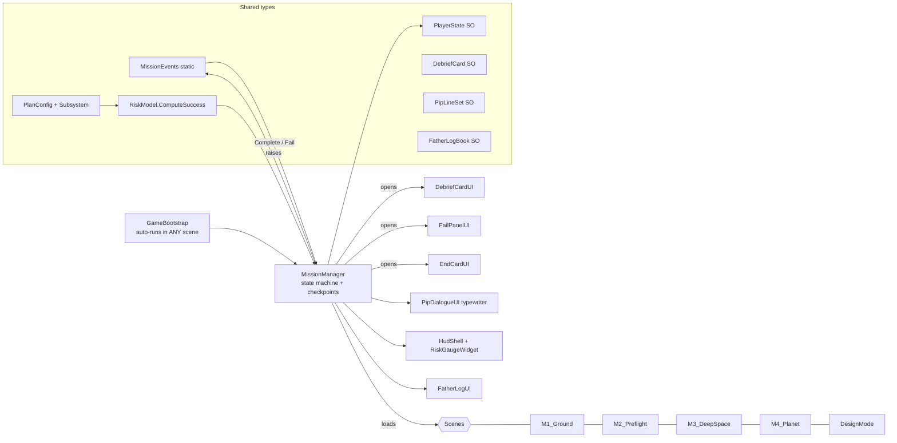

# The Last Known Signal: Core architecture (Person 1)

## Script and scene diagram



State machine: `Boot -> M1 -> M2 -> M3 -> M4 -> Final -> DesignMode`.
Complete: Debrief card, then Continue loads the next scene.
Fail: Fail panel with Pip hint, Retry reloads the scene from the last checkpoint.

## Wireframes

```
HUD (top-left, always on)                 Risk Gauge (reusable prefab/widget)
+------------------------------+          +--------------------------+
| SUPPLIES [########--]  80    |          | SUCCESS PROBABILITY      |
| HULL     [#########-]  90    |          | [#####-----]  49.6 %     |
| POWER    [######----]  60    |          | green >= 70, amber, red  |
| MISSION M2  ·  Preflight     |          +--------------------------+
+------------------------------+

Pip dialogue (bottom)                     Father's log (key L)
+----------------------------------+      +------------------------------+
| (Pip)  Hello. I will keep the    |      | FATHER'S LOG            [x]  |
|        count... _                |      | Day 1: ...                   |
+----------------------------------+      | Day 2: ...                   |
                                          +------------------------------+
Debrief card                              Fail panel
+------------------------------+          +------------------------------+
| MISSION DEBRIEF              |          | MISSION FAILED               |
| <title>                      |          | reason                       |
| Concept: <concept>           |          | Pip: <hint>                  |
| Source:  <NASA source>       |          | [ Retry from checkpoint ]    |
| <body>        [ Continue ]   |          +------------------------------+
+------------------------------+
End card: PLANNED vs ACTUAL success bars + "Enter Mission Design Mode".
Title: game name + [ Begin ].  Stub mission: [Complete] [Fail] buttons.
```

## Data flow rule
Everyone calls `MissionEvents.OnMissionComplete("M1")`. Only `MissionManager` loads scenes.
Reliabilities and mass costs are GAME-BALANCE values, not NASA data.
