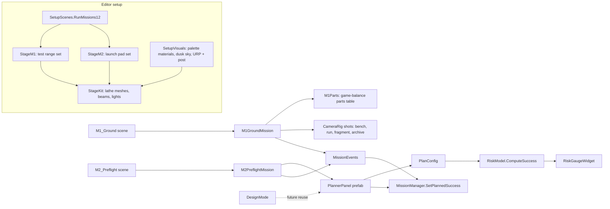

# Missions 1 and 2 and the Mission Planner (person 2)

## Script and scene flow



Every colour comes from `Core/Palette.cs` (the art bible). UI shapes and fonts come from
`Core/UISkin.cs`; all widgets are built by `Core/UIFactory.cs`.

## Mission 1: What Fell to Earth

PLAN: pick one engine and the payload on the sled. RUN: test fire down the rail.

| Rule (game balance, M1Parts.cs) | Value |
|---|---|
| Frame (sled + test frame) | 120 kg |
| Rail-brake mass limit | 270 kg |
| Required acceleration | 16 m/s² |
| E-20 / E-35 / E-50 | 2.4 kN 35 kg / 3.8 kN 60 kg / 5.2 kN 100 kg |
| Required payload | flight recorder 30 kg, telemetry 15 kg |

E-20 is too weak (12.0 m/s²). E-35 and E-50 both pass with only the required payload. Any extra
payload drops the E-35 below 16 m/s² or pushes the E-50 over the brake limit, so the lesson is
a = F / m. Unclamped modules break loose during the run. Every failure returns to the bench with
a Pip hint. A valid run unlocks the archive. The three fragment clues give the serial number, and
the archive query gives the heading and the empty recovery report. Person 6's NASA parts CSV
replaces M1Parts in Sprint 3.

## Mission 2: Ten Percent

1. Open the son's assessment. The Planner loads his plan at 9.9% and record 1 is stored.
2. Fix the plan in the Planner and apply it. Record 2 is stored.
3. Checks run against the applied plan. A subsystem passes when 1 - (1 - r)^n >= 0.895
   (tested, or untested with 3 units). The radio cut passes only with 2 or more comms units.
4. Preflight needs both records, a plan of 70% or more, and all four checks passed. A hold
   names the failing system.

## Planner balance (game-balance values, shown on screen as such)

Per subsystem the player chooses an untested unit (r 0.63, 70% mass) or a tested one (r 0.90),
plus 1 to 3 units, with a 9.5 t budget. Tested unit masses: life support 1.4, comms 0.8,
navigation 0.9, power 1.6, propulsion 2.0 t.

- Son's plan: all untested, 1 unit: 9.9%, 4.7 t.
- Father's plan: all tested, 2 units on comms and life support: 71.5%, 8.9 t.
- All tested plus three backups goes over budget, so the player has to choose.

## Planner wireframe

```text
+------------------------------------------------------------------------------------------+
| | MISSION PLANNER                                   GAME-BALANCE VALUES, NOT NASA DATA [X] |
| SUBSYSTEM        EQUIPMENT (r per unit)        UNITS n     WORKS    MASS  |   .-""-.       |
| Life support     [UNTESTED 63%][TESTED 90%]    [-] 2 [+]   99.0%   2.8 t  |  /      \      |
| Comms            [UNTESTED 63%][TESTED 90%]    [-] 2 [+]   99.0%   1.6 t  |  | 71.5%|      |
| Navigation       ...                                        90.0%   0.9 t  |   SUCCESS      |
| Power            ...                                        90.0%   1.6 t  | PLAN MASS 8.9/9.5|
| Propulsion       ...                                        90.0%   2.0 t  | [#########---] |
| WHY MASS MATTERS: m0 = mf · e^(dv/ve) ...                                | P = .990 × ... |
|                                                                          | Risk briefing  |
|                                                    [LOAD SON'S PLAN] [APPLY PLAN]           |
+------------------------------------------------------------------------------------------+
```

## Screen layout used by M1 and M2 (1920 x 1080)

```text
+--HUD: mission name ------------------- supplies | hull | power | LOG | planned gauge --+
| +-LEFT COLUMN-+                                                    +-RIGHT COLUMN-+     |
| | M1 bench    |              3D set (camera rig)                   | M1 telemetry |     |
| | M2 checks   |                                                    | M2 records   |     |
| |             |        +--Pip dialogue (face, typewriter)--+       |              |     |
| |             |        +-----------------------------------+       |              |     |
| |             |        +--Console: 3 objectives | actions--+       |              |     |
| +-------------+        +-----------------------------------+       +--------------+     |
+-----------------------------------------------------------------------------------------+
```

## Visual verification

- `LastSignal > Capture > Current scene shots` renders every camera shot of the open scene to `Captures/` (3D only).
- Test Runner > EditMode > `CaptureFlowTests.CaptureFlow` (explicit) plays title, M1, M2 and the Planner and saves frames with the UI.
