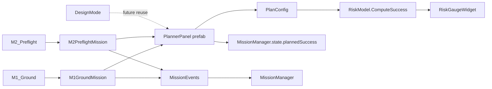

# Mission Planner design

## Script and scene flow



The planner owns a runtime copy of `PlanConfig`. It never mutates the shared
`PlayerState` asset; applying a plan writes only the calculated probability to
the runtime `MissionManager` state. Reliability and mass values are explicitly
game-balance values, not NASA data.

## Planner wireframe

```text
+--------------------------------------------------------------------------+
| MISSION PLANNER                                      [Load son's plan]    |
| Plan mass  7.0 / 10.0 kg  [##############------]  [Apply plan]           |
|                                                                          |
| SUBSYSTEM             RELIABILITY (game balance)   BACKUP       MASS      |
| Life support           [------o---------] 90%       [ ]  +1        1 / 2  |
| Backup comms           [------o---------] 90%       [ ]  +1        1 / 2  |
| Navigation             [------o---------] 90%       [ ]  +1        1 / 2  |
| Power                  [------o---------] 90%       [ ]  +1        1 / 2  |
| Propulsion             [------o---------] 90%       [ ]  +1        1 / 2  |
|                                                                          |
| SUCCESS PROBABILITY                                                       |
| [##########################----------------] 71.5 %                     |
| Risk briefing: weakest subsystem is Life support (90%, one unit)         |
| [Apply plan]                                                             |
+--------------------------------------------------------------------------+
```

## M1 ground-test wireframe

```text
+--------------------------------------+  +-------------------------------+
| TEST FRAME                           |  | PARTS DIAGRAM                  |
| Propulsion module       [Snap]       |  | [Find serial number]           |
| Payload module          [Snap]       |  | Serial: --                     |
| Mass: 0 / 12 kg                      |  | Last heading: --               |
| Acceleration: 0.00 m/s2              |  | [Open recovery report]         |
| [TEST FIRE]                          |  +-------------------------------+
+--------------------------------------+
```

## M2 preflight wireframe

```text
+--------------------------------------+  +-------------------------------+
| SYSTEM CHECKS                        |  | MISSION PLAN                   |
| Life support             [Check]     |  | [Open planner]                 |
| Backup comms             [Check]     |  | Son's plan: 10.0%              |
| Navigation               [Check]     |  | [Load son's configuration]     |
| Emergency radio cut       [Run]      |  | [Preflight]                    |
| Sealed supplies retained: YES        |  +-------------------------------+
| Flight records: --                   |
+--------------------------------------+
```
