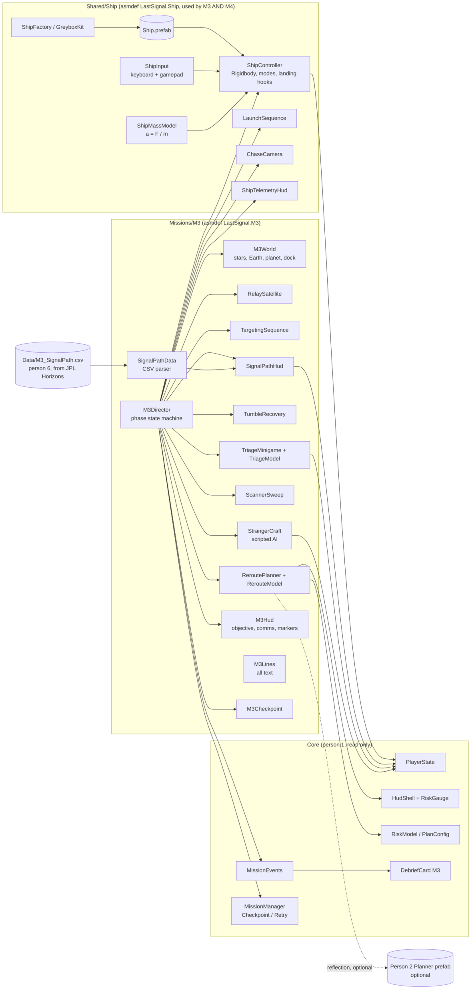
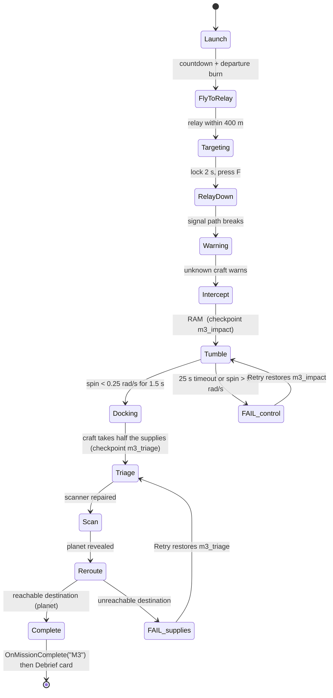

# M3 "The Ship That Came Out of Nowhere": design (person 3)

Owner: person 3 (Flight systems and Mission 3). Folders: `Missions/M3`, `Shared/Ship`.
Scene: `M3_DeepSpace` (only person 3 edits it).

## 1. Scripts and scenes



### M3 phase flow



Two runs for the acceptance demo:
* **Success**: fly, destroy the relay, stabilize, repair Scanner + Engine + Life support, choose the planet.
* **Failure**: after the ram, do nothing (the ship keeps tumbling, so the run fails and Retry restarts at the impact). Or choose Earth in the planner (supplies run out, so the run fails and Retry restarts at triage).

## 2. Ship prefab interface (S0, agree with person 4)

See `Shared/Ship/SHIP_INTERFACE.md`.

## 3. Wireframes (1920 x 1080 reference)

### 3a. Flight HUD (FlyToRelay / Intercept)
```
+--------------------------------------------------------------------------------------------+
| SUPPLIES [#######  ] HULL [#########] POWER [########] FUEL [######   ]   (Core HudShell)   |
| The Ship That Came Out of Nowhere                                                          |
+--------------------------------------------------------------------------------------------+
| SIGNAL PATH                   src: JPL Horizons |        OBJECTIVE: Fly to relay R-7 (612 m)|
| [SHIP]--4 h 02 m-->[RELAY]--4 h 10 m-->[EARTH]  |                                           |
| Ship->Earth one way 8 h 12 m | round trip 16 h  |                                           |
+-------------------------------------------------+                                           |
|                                                                                            |
|                          [ RELAY R-7  612 m ]  <- world marker                             |
|                                   +   <- ship nose reticle                                 |
|                                                                                            |
|                                                                                            |
| W/S thrust  A/D yaw  arrows pitch                    +-----------------------------------+ |
| Q/E roll  Space/Ctrl up/down  X stabilize            | MASS 17.9 t   SPEED 34 m/s        | |
| Shift boost  F fire                                  | a = F / m = 120 kN / 17.9 t       | |
|   +--------------------------------------------+     |   = 6.7 m/s^2   (game balance)    | |
|   | MISSION CONTROL (sent 8 h 12 m ago): ...   |     +-----------------------------------+ |
+--------------------------------------------------------------------------------------------+
```

### 3b. Signal Path HUD, relay destroyed
```
| SIGNAL PATH                           src: JPL Horizons      |
| [SHIP]- - X - - [RELAY X] - - X - - [EARTH]                  |  (red, dashed)
| NO PATH HOME: the relay was a single point of failure        |
```

### 3c. Targeting
```
|                 .-----------------.                     |
|                 |  [ R-7 ]        |  <- relay bracket    |
|                 '-----------------'                     |
|                        ( + )   <- nose reticle          |
|        LOCK  [#########--------]  hold the nose on it   |
|        LOCKED. Press F to fire                          |
```

### 3d. Loss of control (Tumble)
```
|         !!! LOSS OF CONTROL. STABILIZER OFFLINE !!!          |
|        Counter the spin by hand. 18 s left                   |
|   PITCH  [-----|####    ]  nose rising   -> press DOWN       |
|   YAW    [  ###|        ]  turning left  -> press D          |
|   ROLL   [-----|-       ]  steady                            |
|   SPIN 1.42 rad/s   (target < 0.25)                          |
```

### 3e. Damage triage
```
+------------------------- DAMAGE TRIAGE -------------------------+
| Power available: 45      Used: 35 / 45  [###########-----]      |
|                                                                 |
| [x] 1 Scanner             20   Needed to find anywhere to go    |
| [x] 2 Main engine         15   Without it: half thrust          |
| [ ] 3 Life support        10   Without it: supplies drain x2    |
| [ ] 4 Long-range comms    25   No relay left to hear you        |
| [ ] 5 Hull patch          10   +15 hull                         |
|                                                                 |
| Costs are GAME-BALANCE values.          [ CONFIRM REPAIRS ]     |
+-----------------------------------------------------------------+
```

### 3f. Reroute planner (fallback, used when person 2's prefab is not wired)
```
+----------------- REROUTE: SUPPLIES 46 / 100 -------------+   +-- SUCCESS PROBABILITY --+
|  Earth (home)        needs 85   UNREACHABLE              |   | 0%  [               ]   |
|  Outpost Vesta       needs 60   UNREACHABLE              |   | Weakest link: Supplies  |
| >Uncharted planet    needs 30   REACHABLE    <-          |   +-------------------------+
|                                                          |     (Core Risk Gauge)
|  The stranger left you just enough for one place.        |
|  Supply costs are GAME-BALANCE values.  [ SET COURSE ]   |
+----------------------------------------------------------+
```
