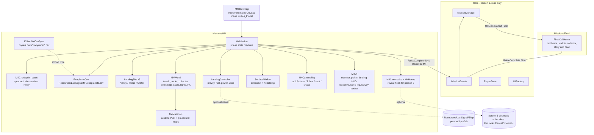

# Mission 4 "Someone's Been Living Here" + Final "Call Home" (Person 4)

Folders: `Missions/M4`, `Missions/Final`. Scene: `M4_Planet` (the Final also runs here: `MissionIds.SceneFor(Final) == "M4_Planet"`).

## 1. Scripts and scenes



Phase flow inside the scene:

```
Orbit+Scan -> SitePicker -> Approach(checkpoint) -> Descent -> Landed
   -> WalkToCollector -> FollowCable -> SonsShip -> SonsLog -> Reveal
   -> SurveyPacket -> Transmit -> RaiseComplete("M4") -> Debrief card
   -> [Final] CallHome -> WalkTogether -> StoryEndCard -> RaiseComplete("Final") -> Core End card
Unsafe touchdown / power loss / boulder / out of area -> RaiseFail("M4") -> Retry -> resumes at Approach
```

## 2. Wireframes

```
ORBIT SCAN (right side)                       SITE PICKER (center)
+-------------------------------------+       +-----------------------------------------------------------+
| PLANET SCANNER                      |       | CHOOSE A LANDING SITE                                     |
| based on Kepler-442 b               |       | +---------------+ +---------------+ +---------------+     |
| Radius ........ 1.34 Earth radii    |       | | A  VALLEY     | | B  RIDGE      | | C  CRATER     |     |
| Insolation .... 0.70 x Earth        |       | | Water  ####-  | | Water  #---- | | Water  ###--  |     |
| Eq. temp ...... 233 K (-40 C)       |       | | Slope   3 deg | | Slope  14 deg | | Slope   8 deg |     |
| Orbital period  112.3 days          |       | | Solar  ####-  | | Solar  ##### | | Solar  #----  |     |
| Gravity est. .. 1.5 g (model)       |       | | Beacon  120 m | | Beacon 430 m | | Beacon 370 m  |     |
| src: exoplanets.csv (NASA Exoplanet |       | | Risk: LOW     | | Risk: HIGH   | | Risk: MEDIUM  |     |
|      Archive)                       |       | +---------------+ +---------------+ +---------------+     |
| [ Choose landing site ]             |       |  selected: details + effect on landing   [ Begin descent ] |
+-------------------------------------+       +-----------------------------------------------------------+

LANDING HUD (right)                          OBJECTIVE (top center) + PROMPT (center low)
+-----------------------------+              +----------------------------------------------+
| DESCENT · SITE A VALLEY     |              |  OBJECTIVE  Follow the cable to the ship     |
| ALT        142.0 m          |              |             86 m  >                          |
| V-SPEED    -6.1 m/s  (3.0)  |              +----------------------------------------------+
| H-SPEED     2.3 m/s  (1.5)  |                        [E] Read the water collector
| FUEL   [######----]  58     |
| POWER  [########--]  81 -0.4/s
| THROTTLE [###-------]       |
| WIND  -> 0.3 m/s2           |
| TARGET 31 m                 |
| SPACE thrust · WASD RCS     |
+-----------------------------+

SON'S TRANSMISSION LOG (center)              SURVEY PACKET (center)
+-------------------------------------+      +-------------------------------------------+
| LK-2590 · TRANSMISSION LOG          |      | SURVEY PACKET FOR EARTH                   |
| ATTEMPTS  4,381   (counting up)     |      | [x] Landing coordinates  12.44 S 141.21 E |
| 0001 Day   3  NO CARRIER            |      | [x] Water readings  312 L, 97.4 %         |
| 0412 Day  88  NO CARRIER            |      | [x] Father's flight log  (7 entries)      |
| ...                                 |      | [x] Son's flight log  (4,381 attempts)    |
| Day 611  A ship. NASA colours. Dad? |      | ANTENNA  [-----|==^==|-----]  A/D align   |
|                       [ Continue ]  |      | [ TRANSMIT ]   [#######---] 70 %          |
+-------------------------------------+      +-------------------------------------------+

REVEAL / CALL HOME (letterbox)               STORY END CARD
+=====================================+      +-------------------------------------------+
|                                     |      |        THE LAST KNOWN SIGNAL              |
|     (camera push-in, depth of field)|      |  Year 2590. Survey received.              |
|                                     |      |  Two pilots. One ship. Coming home.       |
|  SON: That was me.                  |      |                         [ Continue ]      |
+=====================================+      +-------------------------------------------+
```

## 3. S0 interface agreement with person 3 (Ship prefab + landing hooks)

Proposed contract (nothing here edits person 3's files):

| Item | Owner | Contract |
|---|---|---|
| Ship visual | P3 | Optional prefab at `Resources/LastSignal/Ship` (any folder named Resources). Pivot at the bottom of the landing legs, +Z forward, +Y up, about 6 m tall. No Rigidbody, no scripts that read input. If it is missing, M4 uses its own greybox lander. |
| Engine socket | P3 | Optional child transform named `EngineSocket` (bottom of the main engine). M4 attaches its plume and dust there. |
| Ship state in | P1 | M4 reads `PlayerState.fuel` (floor 55) and `PlayerState.power` at the approach; the descent battery is `clamp(power, 40, 65)` so a bad M3 run is still landable. After touchdown it writes back fuel and the power actually used. |
| Landing hooks out | P4 | `M4Hooks.OnPhaseChanged(string)`, `M4Hooks.OnLanded(bool success, string reason)`, `M4Hooks.OnSurveyTransmitted` (static events; anyone may subscribe). |
| Reveal cinematic | P5 | Subscribe to `M4Hooks.RevealCinematic += (done) => { /* play */ done(); }`. If nobody subscribes, M4 plays its built-in camera + subtitle fallback. |

Reliabilities, fuel burn, power drain, wind and touchdown limits in M4 are **game-balance values, not NASA data**.
Exoplanet values (radius, insolation, equilibrium temperature, orbital period) come from the CSV.

## 4. Tuning check (done outside Unity, numbers from a Python port of the same formulas)

| Site | Slope in a 20 m disc | Landable (< 15 deg) | Careful descent: battery left from 40 | Effect |
|---|---|---|---|---|
| A Valley | 1 to 10 deg | 100 % | 17 | Easy: wide ellipse, 3.0 m/s limit, calm air |
| B Ridge | 1 to 15 deg | 98 % | 25 | Hard: 1.7 m/s limit, 0.9 m/s sideways, gusts up to 2.4 m/s2, 10 m ellipse |
| C Crater | 0 to 4 deg | 100 % (but boulders) | -17 (fails unless you descend fast) | Hard: shadow drains 1.5 %/s, boulder field, 11 m ellipse |

Game gravity = 2.4 m/s2 x the CSV-based gravity estimate (Kepler-442 b: 1.55 g -> 3.7 m/s2).

## 5. Debug keys (Editor only)
F5 approach at site A · F6 land now · F7 jump to the reveal · F8 start the Final.
